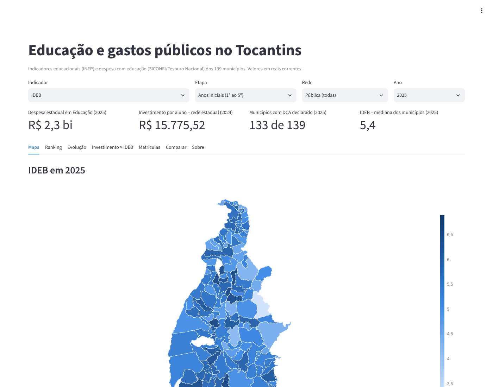
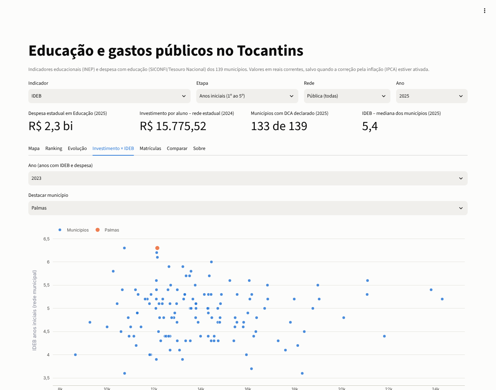
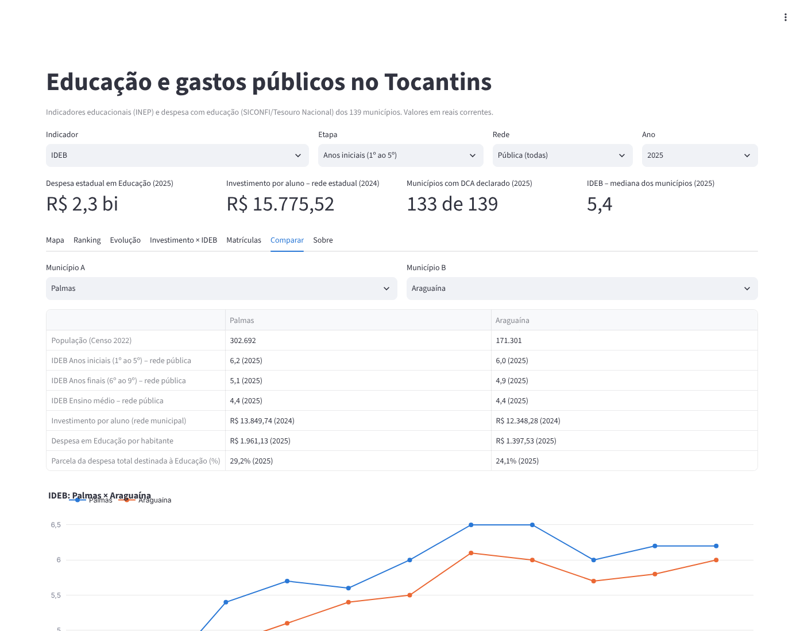
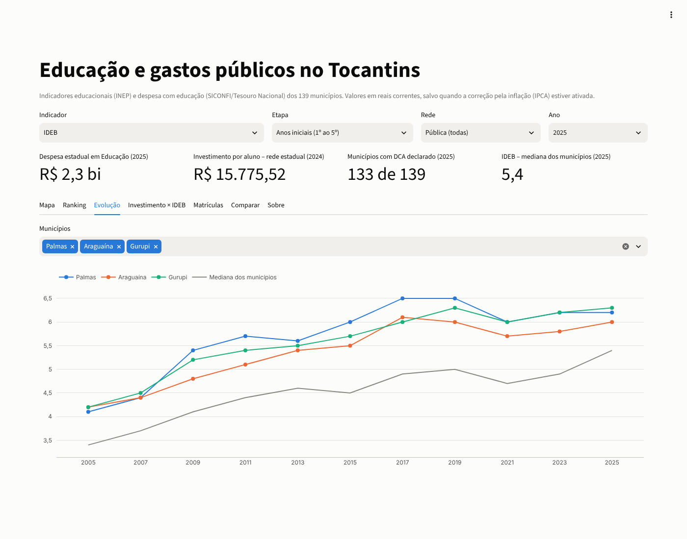
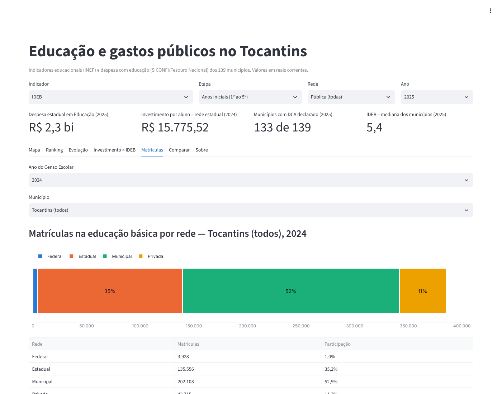

# 🗂️ Dados Abertos Tocantins

> Pipeline de dados que coleta informações públicas do Tocantins (educação e gastos públicos), trata, valida a qualidade e publica um painel aberto para qualquer cidadão consultar.

 [](https://github.com/rafantavares/dados-abertos-tocantins/actions/workflows/ci.yml) [](https://github.com/rafantavares/dados-abertos-tocantins/actions/workflows/pipeline.yml)   

## Por que este projeto existe

Os dados públicos do estado existem, mas estão espalhados em portais diferentes, em formatos variados e sem contexto. Este projeto junta essas fontes em um modelo único e responde perguntas como:

- Como evoluíram os indicadores de educação nos municípios do Tocantins?
- Quanto o estado e os municípios investem em educação por aluno?
- Existe relação entre investimento e resultado educacional?

## Arquitetura

```
Fontes públicas (INEP, SICONFI, IBGE)
        │  extração agendada (GitHub Actions: pipeline.yml)
        ▼
  camada bruta (raw) ──► dbt: staging → intermediária → marts
                                        │   testes de qualidade
                                        ▼
          DuckDB publicado na branch `dados` ──► painel Streamlit (local)
```

Arquitetura em camadas (medalhão): **bruta** guarda o dado como veio; **staging** padroniza nomes e tipos; **marts** entrega tabelas prontas para análise.

## Fontes

Validadas em 02/11/2026 (issue #1). Detalhes, licenças e evidências em [`docs/fontes.md`](docs/fontes.md); perguntas de negócio e dicionário em [`docs/dicionario.md`](docs/dicionario.md).

| Tema | Fonte adotada | Observação |
|---|---|---|
| Indicadores educacionais | INEP – IDEB por município (2005–2023) e microdados do Censo Escolar | Download direto do INEP |
| Gastos públicos | Tesouro Nacional – SICONFI, DCA Anexo I-E (despesa por função) | Substitui o Portal da Transparência TO, inacessível |
| Dados municipais | IBGE – DTB 2022, malha municipal 2022, SIDRA (Censo 2022 e estimativas) | Substitui a API `servicodados`, inacessível |
| Catálogo federal | Portal Brasileiro de Dados Abertos | Apenas referência (API exige token) |

## Stack

Python 3.12 · httpx · DuckDB · dbt-duckdb · pandas · Streamlit · pytest · Ruff · GitHub Actions

## Qualidade de dados

- Testes do dbt: unicidade (inclusive de chaves compostas), não nulos, integridade referencial, valores aceitos e faixas válidas, além de testes unitários das regras de limpeza
- Sinalização de declarações inconsistentes (ex.: DCA com Educação abaixo de 5% da despesa), com teste em severidade *warn*
- Contagem de linhas por carga, com **alerta quando a variação é anormal**: o job falha, nada é publicado e uma issue `alerta-carga` é aberta (detalhes em [`docs/operacao.md`](docs/operacao.md))
- Registro de cada execução de extrator em `raw._cargas`; uma fonte fora do ar mantém a carga anterior sem derrubar as demais
- Documentação das tabelas gerada pelo `dbt docs` e publicada na branch `dados` (`documentacao_dbt.html`)

## Roadmap

| Milestone | Entrega | Status |
|---|---|---|
| **M1 – Descoberta** | Inventário das fontes, licenças e dicionário de dados | ✅ |
| **M2 – Ingestão** | Extratores com carga incremental e camada bruta | ✅ |
| **M3 – Modelagem** | Modelos dbt (staging → marts) com testes | ✅ |
| **M4 – Painel** | Painel com mapas e comparativos por município (roda localmente) | ✅ |
| **M5 – Automação** | Atualização agendada, monitoramento e documentação | ✅ |

## Documentação

- [`docs/fontes.md`](docs/fontes.md): fontes, licenças e validação
- [`docs/dicionario.md`](docs/dicionario.md): perguntas de negócio e dicionário de dados
- [`docs/operacao.md`](docs/operacao.md): atualização agendada, alertas e investigação
- [`docs/retrospectiva.md`](docs/retrospectiva.md): o que foi entregue, decisões, problemas de dados e pendências

## Painel

O painel roda **localmente** com Streamlit e lê o banco DuckDB publicado pelo
pipeline na branch [`dados`](https://github.com/rafantavares/dados-abertos-tocantins/tree/dados).
Ele tem mapa coroplético, ranking, evolução temporal, investimento × IDEB,
matrículas por rede e comparação entre dois municípios.



| Investimento por aluno × IDEB | Comparação entre municípios |
|---|---|
|  |  |
| **Evolução temporal** | **Matrículas por rede** |
|  |  |

Capturas geradas com Playwright (`scripts/capturar_telas.cjs`) a partir dos dados reais.

| Variável | Padrão | Uso |
|---|---|---|
| `DADOS_DUCKDB_URL` | `https://raw.githubusercontent.com/rafantavares/dados-abertos-tocantins/dados/tocantins.duckdb` | URL do banco; baixado para `~/.cache/dados-tocantins` |
| `DADOS_CACHE_HORAS` | `6` | Por quanto tempo reaproveitar o banco baixado |
| `DADOS_DUCKDB_PATH` | — | Banco local (tem prioridade sobre a URL) |

## Como rodar

```bash
git clone https://github.com/rafantavares/dados-abertos-tocantins
cd dados-abertos-tocantins
python -m venv .venv && source .venv/bin/activate
pip install -e ".[dev,painel]"
```

Painel com os dados publicados (não precisa rodar o pipeline):

```bash
streamlit run app/painel.py
```

Pipeline completo offline, com as amostras reais de `tests/fixtures`:

```bash
python -m pipeline.extrair --fixtures
dbt build --project-dir transform
DADOS_DUCKDB_PATH=data/tocantins.duckdb streamlit run app/painel.py
```

A extração real (`python -m pipeline.extrair`, sem `--fixtures`) precisa de acesso aos
sites do INEP, do IBGE e do Tesouro; no projeto ela roda no GitHub Actions
(workflow **Pipeline de dados**), que publica o banco na branch `dados`.

## Autor

**Rafael Nunes Tavares** — estudante de Engenharia de Software (ULBRA Palmas)
[GitHub](https://github.com/rafantavares)

## Licença

Código sob [MIT](LICENSE). Os dados pertencem às suas fontes originais e seguem as licenças de cada uma.
